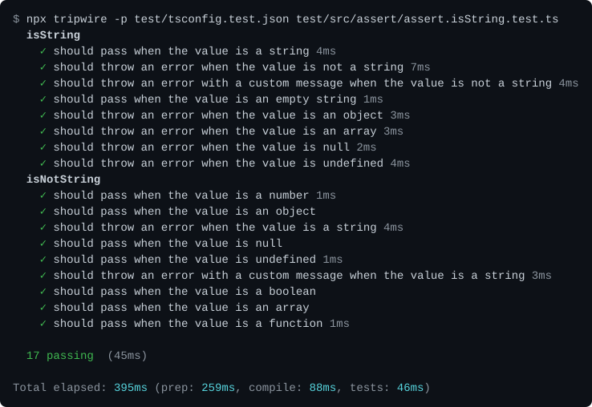
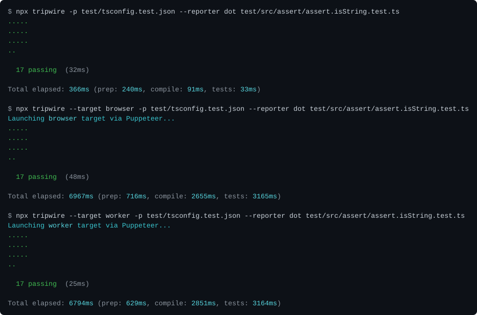
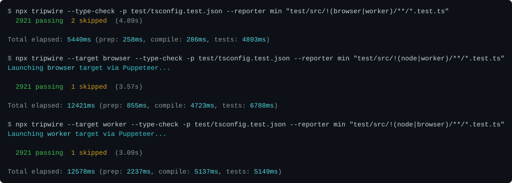
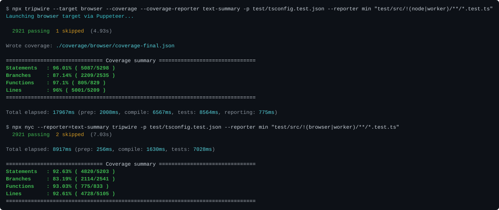
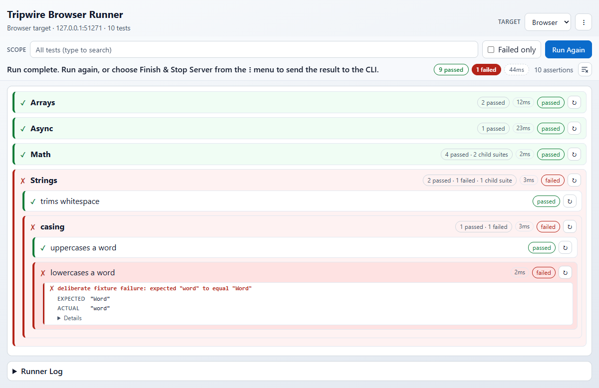
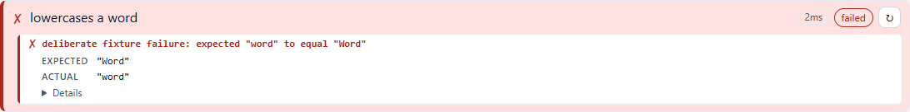
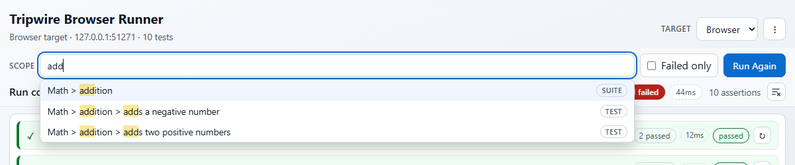
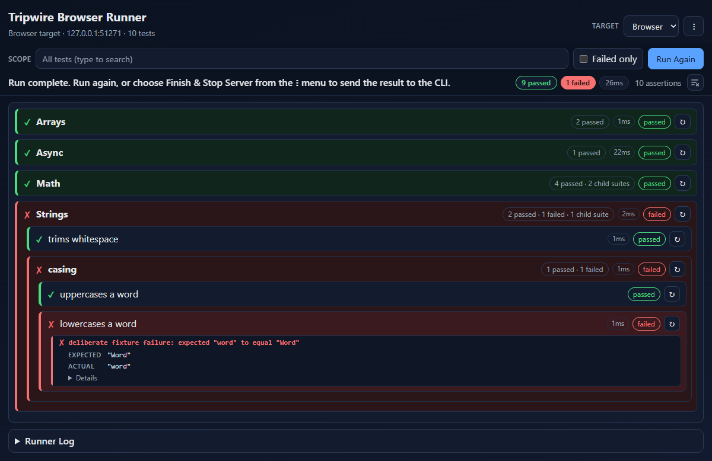
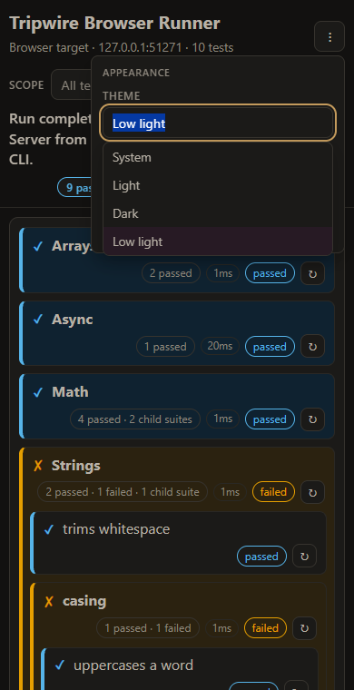

# Tripwire in action

Tripwire's promise is short: **write your tests once, and run them on node, in a real browser and
inside a web worker** -- with TypeScript, coverage and an interactive page for debugging built in,
and without a bundler, a TypeScript loader or a browser launcher to configure.

This page shows that on a real project: tripwire's own. Every terminal image below is a run of
tripwire's `core` test suite (2,900+ tests), and every browser image is the interactive page the
runner's own tests drive. Nothing is mocked up -- the images are regenerated from actual runs by
[`docs/scripts/genTourImages.js`](#regenerating-these-images).

- [Write the tests once](#write-the-tests-once)
- [Run them on node, in a browser and in a web worker](#run-them-on-node-in-a-browser-and-in-a-web-worker)
- [A real project: tripwire's own suite](#a-real-project-tripwires-own-suite)
- [Coverage from the command line](#coverage-from-the-command-line)
- [Debug in a real browser](#debug-in-a-real-browser)
- [And it is fast](#and-it-is-fast)
- [Regenerating these images](#regenerating-these-images)

## Write the tests once

A tripwire test file is a plain `describe`/`it` suite, with `assert` and `expect` built in. This is
the start of one of tripwire's own, `core/test/src/assert/assert.isString.test.ts`:

```ts
import { assert } from "../../../src/assert/assertClass";
import { expect } from "../../../src/assert/expect";
import { checkError } from "../support/checkError";

describe("isString", () => {
    it("should pass when the value is a string", () => {
        assert.isString("test");
        expect(() => assert.isString("test")).to.not.throw();
    });

    it("should throw an error when the value is not a string", () => {
        checkError(() => {
            assert.isString(123);
        }, "expected 123 to be a string");

        expect(() => assert.isString(123)).to.throw();
    });
```

(It imports from `src/` because it tests tripwire itself; your tests import
`@nevware21/tripwire`.) There is nothing in it about where it runs: no environment checks, no
browser or worker adapter, no build step. Run it:



## Run them on node, in a browser and in a web worker

The same file, unchanged, on all three targets -- the only difference is `--target`:



- **node** runs it in-process, compiling the TypeScript against your `tsconfig.json` on the fly.
- **browser** builds the module graph, serves it from the runner's own loopback server and runs it
  in **real headless Chrome**, launched by puppeteer -- not a simulated DOM.
- **worker** runs it inside a **real `Worker`** in that Chrome, and reports back over the runner's
  own channel.

Same tests, same 17 results. Nothing was configured for the browser or the worker: no webpack or
rollup, no karma, no launcher plugins, no `ts-node` or `ts-jest`, no worker adapter -- the runner
reads the `tsconfig.json` and does the rest. See [Test Targets](test-runner.md#test-targets) for
the launch modes, including `--browser-launch open` (your own browser) and `manual` (a URL for any
browser or device).

## A real project: tripwire's own suite

Tripwire tests itself this way. These are `core/package.json`'s own scripts -- one glob per target,
and the same test files in each:

```json
"test:node":    "nyc --cache node ./bin/tripwire.js --type-check -p ./test/tsconfig.test.json \"./test/src/!(browser|worker)/**/*.test.ts\" ...",
"test:browser": "node ./bin/tripwire.js --target browser --coverage --type-check -p ./test/tsconfig.test.json \"./test/src/!(node|worker)/**/*.test.ts\"",
"test:worker":  "node ./bin/tripwire.js --target worker --coverage --type-check -p ./test/tsconfig.test.json \"./test/src/!(node|browser)/**/*.test.ts\""
```

The globs only leave out the two small folders that hold each *other* target's own checks
(`test/src/node`, `test/src/browser` and `test/src/worker` hold two files each, such as
`isBrowser.test.ts`). Everything else -- 120-odd files -- runs everywhere:



2,921 tests passing on each target, from one set of files. The `shim/chai` package (tripwire's
Chai-compatible API) does the same with its own suite.

## Coverage from the command line

On the **browser and worker** targets, coverage is one flag: `--coverage`. The runner instruments
the module graph itself, also loads the sources no test imported (`--coverage-src`, default
`src/**/*.ts`) so an untested file is reported at 0% rather than silently missing, writes
`coverage/<target>/coverage-final.json`, and prints each `--coverage-reporter` you ask for.

On the **node** target, coverage is the standard `nyc` wrapper -- `nyc tripwire ...` -- so it is one
command rather than one flag, and uses your existing `.nycrc`.



Each report covers the code that ran on its target, which is why the two differ: code that only
runs in a browser counts towards the browser's figure, and node-only code towards node's. Both are
what `core`'s own `npm test` produces. See [Coverage](test-runner.md#coverage) for the reporters,
`--coverage-src` and how files TypeScript erased entirely are counted.

## Debug in a real browser

`--browser-launch open` (or `--open-browser`) runs the browser or worker target in your own browser
and keeps the page open; `--browser-launch manual` prints its URL for any browser or device. The
page runs the suite, shows the results as they arrive, and sends the final result back to the CLI
when you choose **Finish & Stop Server**:

```bash
npx tripwire --target browser --open-browser "test/**/*.test.ts"
```



A failure shows its message once, the values it compared, and the rest of the error folded under
**Details**:



The **Scope** box searches every suite and test, in any order of words, and the next run covers
just that; each result also has a **run again** button for exactly that suite or test, and the
scope is kept in the URL so a reload or a bookmark brings it back:



**Auto-reload** re-runs when a test file changes on disk, **Failed only** hides the noise, the
**Runner Log** shows the reporter's output in its terminal colours, and the page switches between
the browser and worker targets in place. It follows your system's light or dark setting:



and it is built for everyone: usable from the keyboard alone and with a screen reader, with a low
light theme, a color-blind safe palette (blue and orange in place of green and red) and a zoom from
50% to 300% that scales the page's own controls and nothing else -- never the browser, or a test's
own content. All three are in the **Appearance** panel, whose theme is a box you search, or set
with `--browser-theme dim,colorblind,125%` on the command line. On a narrow window, controls fold
into the menu rather than crowding the page:



Everything on the page is described in [The interactive page](test-runner.md#the-interactive-page)
and [Themes and accessibility](test-runner.md#themes-and-accessibility).

## And it is fast

Measured on this repository's own suites (2026-10-18; full method, machine and caveats on the
[performance page](performance.md)):

| Target | Suite | tripwire | Alternative |
|---|---|---|---|
| node | `core` | **6.07 s** | 9.13 s (ts-mocha) |
| node | `shim/chai` | **1.06 s** | 2.70 s (ts-mocha) |
| browser | `core` | **14.00 s** | 19.42 s (karma) |
| browser | `shim/chai` | **10.07 s** | 11.19 s (karma) |
| worker | `core` | **12.57 s** | 19.24 s (karma) |
| worker | `shim/chai` | **9.69 s** | 10.98 s (karma) |

Where it comes from: one TypeScript program per run, emitting only the files the run loads; a
`--type-check` that is a walk over that same program rather than a `tsc` process; a compile cache
that takes a repeat node run over an unchanged tree from 9.3 s to 5.2 s; and Chrome launched while
the module graph is still building. Coverage on keeps tripwire ahead in all six comparisons. The
[performance history](performance/history.md) charts every recorded run.

## Regenerating these images

Every image here comes from a real run, so it can be made again whenever the runner changes:

```bash
npm run docs-tour-images
```

This runs the built CLI over `core`'s suite for the terminal images and drives the interactive
page with puppeteer for the browser ones; it needs the runner built and puppeteer's Chrome
installed. Timings in the images are as measured on the machine that made them. Add
`-- terminal` or `-- browser` to make just that set.
